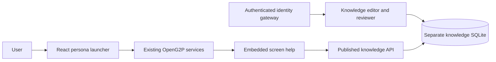

# Integration guide

## Architecture



This layer never opens the registry, PBMS, banking or beneficiary databases. Native service logins and authorization continue to govern those services. Knowledge guidance is public, even when labeled with an audience; do not publish confidential operational instructions.

## Identity gateway contract

The kit supports trusted proxy identity, suitable for a verified OIDC/Keycloak gateway or an application backend adapter. It does **not** implement an OIDC login itself.

After authenticating the request, the gateway must discard any client-supplied `X-Experience-*` headers and inject:

| Header | Value |
|---|---|
| `X-Experience-Gateway` | A private shared secret matching `EXPERIENCE_GATEWAY_SECRET` |
| `X-Experience-Subject` | Stable verified identity subject |
| `X-Experience-Name` | Optional display name |
| `X-Experience-Roles` | Comma-separated validated identity roles |

Do not derive these from unverified query parameters, browser persona selection, or arbitrary request headers. Bind the backend to loopback/private networking; expose it through the authenticating gateway. Headers without the matching secret are ignored. When no gateway is configured the public preview works and management remains inaccessible. The default role names are `knowledge-editor`, `knowledge-reviewer`, `knowledge-publisher`; change the role map to match the target realm. Reviewers/publishers can also open the management interface through the edit mapping.

Set random, persistent `EXPERIENCE_SESSION_SECRET` and `EXPERIENCE_GATEWAY_SECRET` through your secret manager. Never put these in `deployment.json`, source control or browser config. The session cookie carries a CSRF token; mutation forms validate it. Use HTTPS and `EXPERIENCE_SECURE_COOKIE=1` in deployment. Configure `EXPERIENCE_CONFIG` and `EXPERIENCE_DATABASE` as required. Published metadata and embed configuration contain no gateway secret.

## Embed help on a native service

Serve these assets under a permitted shared origin or copy them to each service's approved static directory. Load scripts in this order:

```html
<link rel="stylesheet" href="https://help.example.org/experience/static/help.css">
<script defer src="https://help.example.org/experience/embed/config.js"></script>
<script defer src="https://help.example.org/experience/static/context-presets.js"></script>
<script defer src="https://help.example.org/experience/static/context.js"></script>
<script defer src="https://help.example.org/experience/static/shell.js"></script>
<script defer src="https://help.example.org/experience/static/help.js"></script>
```

Allow these origins in the target application's CSP `script-src`, `style-src`, and `connect-src`, and list the exact target origin in the kit's `allowed_origins`. The help API uses `credentials: omit`; guidance is public and no session token is shared across applications. Do not inject the helper on authentication screens.

Prefer precise attributes on the active screen or workflow section:

```html
<main data-km-screen="intake" data-km-module="intake"
      data-km-stage="Household details" data-km-persona="officer">
  <h1>Household registration</h1>
</main>
```

Attribute values must match the article's `module` and `stage` exactly. Explicit attributes override configurable route mappings, which override native route/topic presets. For each service test routes, modals, tabs, SPA navigation and relevant persona filters. Unknown mappings show a missing-guidance message rather than a guessed task. Changes to `screen_mappings` are reflected through `embed/config.js` after restarting the kit. Stage help updates with focus, visible sections and route changes.

## Deployment

The kit uses `/experience` by default and listens on port 18110. If you change `prefix`, update relative service links, route rules and your proxy consistently.

Docker Compose builds the supplied bundle and binds port 18110 to loopback. Set the two secret environment variables, then run `docker compose up -d --build`. The production command uses Gunicorn with one worker and four threads. The volume retains `knowledge.sqlite`; SQLite is intended for a single service instance. For multiple replicas, implement a shared transactional store and locking/version semantics before scaling.

Forward `/experience/` unchanged to the backend. An ordinary reverse proxy is enough for public reading; management requires the authenticated header contract above. No automatic modifications to existing OpenG2P ingress or nginx configurations are included. Docker files are templates and must be validated on the destination environment.

## Content and upgrades

Seed entries are inserted once by slug. Editing `knowledge-seed.json` does not overwrite existing articles. Use the editorial UI for revisions, or add new validated unique slugs before restarting. All imported seed guides start published; review the starter content before a public launch, remove unsuitable entries before first startup, or archive them as a publisher afterward. Upstream guides can describe features absent from a particular release.

## Backup and rollback

Back up `config/deployment.json`, your secret-manager entries separately, source/build artifacts and the knowledge database. Stop only this service during a file copy, or use Python SQLite's online backup API. Verify `PRAGMA integrity_check` on the copied database. Do not copy a live SQLite file without accounting for journal/WAL state. Roll back by restoring the previous kit files and knowledge database to this service. The kit does not migrate or restore core OpenG2P databases.

## Acceptance checklist

- Enable only installed services and verify their destination URLs.
- Test each persona's navigation and native login/permissions.
- Confirm the authenticated gateway strips spoofed headers.
- Verify editor, independent reviewer and publisher accounts; test failed self-review.
- Check screen help on each installed application and on a narrow mobile screen.
- Check guidance wording against the target release and local workflow.
- Verify backup/restore and CSP/CORS integration.
